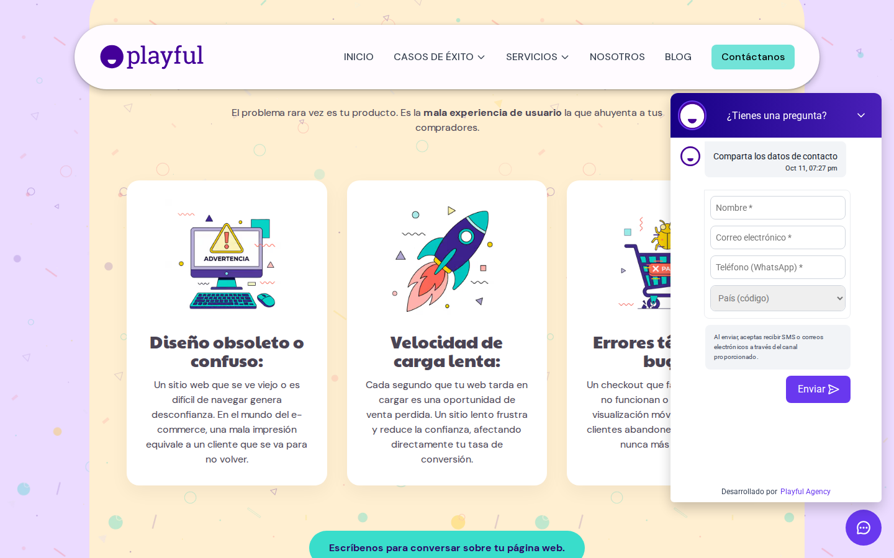

# QA producción: evento `chat_lead` (#232)

**Sitio:** https://playfulagency.com/  
**Herramienta:** Playwright 1.64, Chromium headless 156, viewport 1440×900, `Europe/Madrid`  
**Alcance:** sin cambios de código; un único intento de envío autorizado. No se envió.

## Resultado

| Pregunta | Respuesta |
|---|---|
| Hora del envío (Madrid, con segundos) | **No hubo envío.** Prueba iniciada a las **19:27:07**. Chat abierto a las **19:27:11**. `chat_open` en collect a las **19:27:16**. Detención a las **19:27:45**. |
| ¿El chat confirmó el envío? | **No.** No se pulsó Enviar. |
| ¿Se disparó `chat_lead` en dataLayer? | **No.** |
| ¿Se disparó `chat_lead` en `/g/collect`? | **No.** Cero hits con `en=chat_lead`. |
| Motivo | El campo **Teléfono (WhatsApp)\*** es obligatorio (`required` + asterisco). Instrucción: si el teléfono es obligatorio, parar sin enviar. |

Captura del chat abierto (formulario previo, teléfono obligatorio visible):



URL raw (rama `cursor/qa-chat-lead-prod-a0cd`):

https://raw.githubusercontent.com/devplayful/playful-headless/cursor/qa-chat-lead-prod-a0cd/docs/qa/2026-10-11-chat-lead-prod/chat-abierto-telefono-obligatorio.png

## Qué sí se comprobó

1. Tras scroll/clic en la home, el loader de GHL se inyecta (`#240`). Consola: `ChatWidget: Script de chat agregado al DOM` y `Widget de High Level cargado`.
2. El custom element `chat-widget` hidrata. La API `window.leadConnector.chatWidget` expone `openWidget`, `isActive` y `registerBeforeSubmit`.
3. Al abrir el bubble, el hook de producción **sí está registrado**. `beforeSubmit.toString()`:

```js
function f(e,t){try{d("chat_lead")}catch(e){}return!0}
```

Eso coincide con `handleChatBeforeSubmit` de `lib/analytics/chat-widget.ts` (minificado): dispara `chat_lead` y siempre devuelve `true`.

4. El mismo cableado **sí disparó `chat_open`** al abrir el widget. Eso demuestra que `sendGtagEvent` → `gtag` → dataLayer → collect funciona en producción.

### dataLayer / gtag (`chat_open`, 19:27:11 Europe/Madrid)

```js
gtag('event', 'chat_open', {
  page_path: '/',
  event_timeout: 300,
  event_callback: [fn]
})
```

### collect (`chat_open`, 19:27:16 Europe/Madrid)

`POST https://analytics.google.com/g/collect`

| Parámetro | Valor |
|---|---|
| `en` | `chat_open` |
| `tid` | `G-WH76RQWSCT` |
| `dl` | `https://playfulagency.com/` |
| `dp` | `/` |
| `cid` | `217864990.1791739628` |
| `_ee` | `1` |

`page_path` viajó en el push de gtag; no apareció como `ep.page_path` en la query del collect.

### GTM

Cargó `https://www.googletagmanager.com/gtm.js?id=GTM-MXHKJ4NW` y `gtag/js?id=G-WH76RQWSCT`. También `page_view` a las 19:27:08 (`en=page_view`, mismo `tid`). No hay banner de cookies que bloquee el hit.

## Formulario del chat (por qué no se envió)

No hay textarea de mensaje en el primer paso. El panel es un formulario de contacto:

| Campo | Placeholder | `required` |
|---|---|---|
| name | Nombre \* | sí |
| email | Correo electrónico \* | sí |
| phone | Teléfono (WhatsApp) \* | **sí** |
| country | País (código) | no |

El texto «Prueba interna de medición, no responder» solo podría enviarse **después** de este formulario. Completar el lead exige teléfono; por eso no se envió nada.

## Dónde debería dispararse `chat_lead` y por qué no lo hizo

Debería dispararse en `handleChatBeforeSubmit` (`lib/analytics/chat-widget.ts`), registrado con `leadConnector.chatWidget.registerBeforeSubmit` cuando GHL emite `LC_chatWidgetLoaded` (y de nuevo en `attachChatWidgetAnalytics` si la API ya existe). Ese hook llama a `sendChatEvent('chat_lead')` → `sendGtagEvent` (`lib/analytics/gtag-event.ts`) → `gtag('event', 'chat_lead', { page_path, event_timeout })`.

**No lo hizo porque GHL no invocó `beforeSubmit`:** no hubo submit. No es un fallo de registro ni de gtag: el hook está en el widget y `chat_open` (misma función `sendChatEvent`) sí salió a collect.

Para verificar `chat_lead` en GA hace falta o bien un envío real con teléfono (otro brief), o que Analytics deje el teléfono opcional en el widget GHL `67ac6d90a81d1c5969d763e7`.

Evidencia bruta: [`evidence.json`](./evidence.json).
